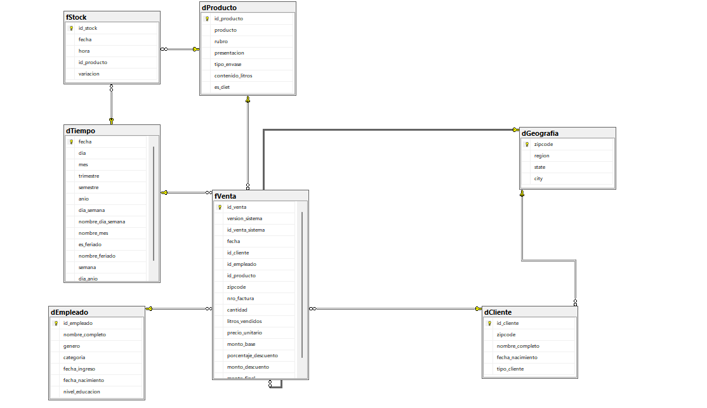
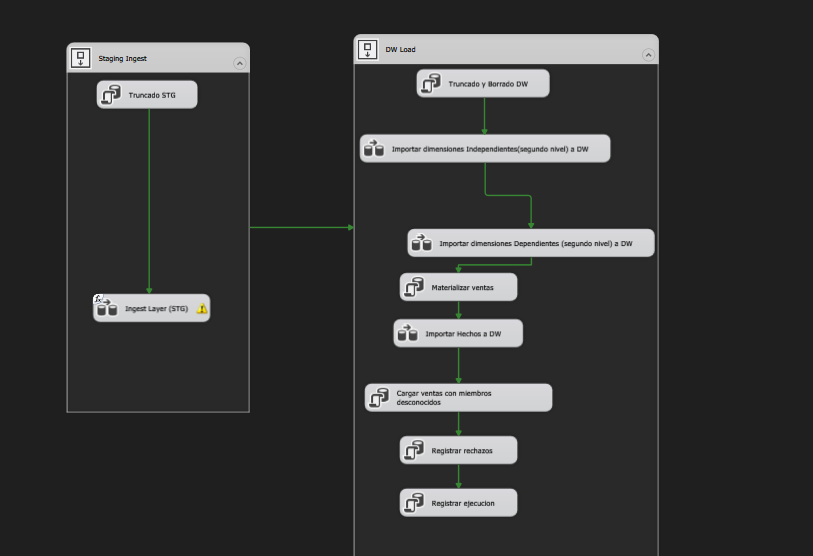
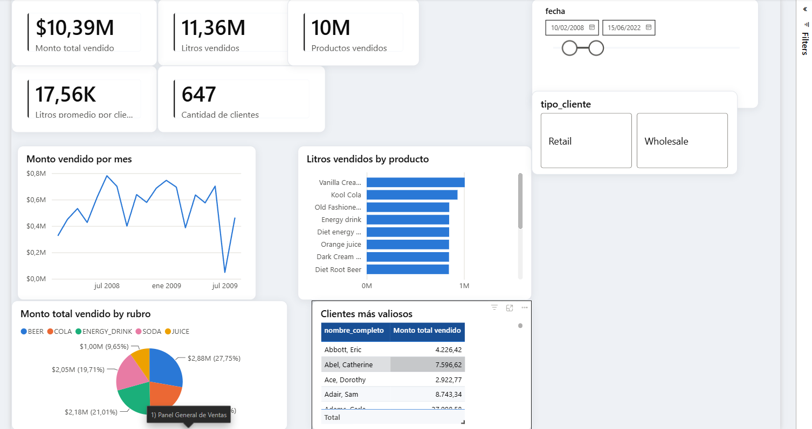
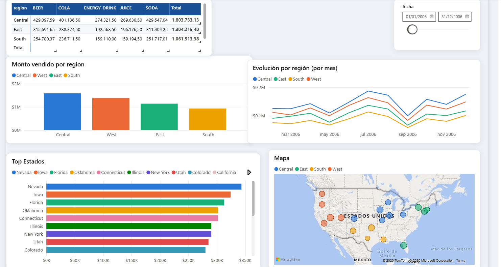

# Capturas del proyecto en ejecución

Cómo se ve el proyecto funcionando, de punta a punta: el modelo del Data Warehouse, el paquete de
SSIS que lo carga y dos paneles del tablero de Power BI. Para instalarlo y ejecutarlo, ver el
[README](README.md).

## Modelo dimensional del Data Warehouse

Dos tablas de hechos: `fVenta` (una fila por línea de factura) y `fStock` (movimientos de stock).
Comparten las dimensiones `dTiempo` y `dProducto`; las ventas además se analizan por cliente,
empleado y geografía. `dCliente` se relaciona con `dGeografia` por el zipcode.

## Paquete de SSIS

- **Staging Ingest**: vacía las tablas de staging y copia las fuentes (SQL Server, MySQL, XML,
  Excel y texto) a `STAGING_TDC`.
- **DW Load**: vacía el DW, carga las dimensiones, calcula las ventas una sola vez
  (*Materializar ventas*), carga los hechos, suma las ventas con cliente o empleado desconocido,
  registra los rechazos y deja una fila de auditoría por corrida.

## Power BI: panel general de ventas

Indicadores principales (monto, litros, productos, clientes), evolución mensual del monto, litros
por producto, participación de cada rubro y clientes más valiosos, con filtros por fecha y tipo de
cliente.

## Power BI: panel de geografía

Litros por región y rubro, monto por región, evolución mensual por región, ranking de estados y
mapa con el monto vendido en cada estado.
